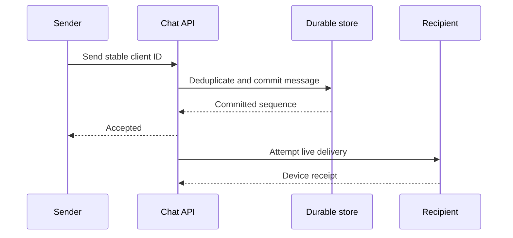

## 1. Absolutely Important Invariants

### Primary invariants

| Must remain true | Why it matters | What violates it | Enforcement |
| --- | --- | --- | --- |
| An accepted message is recoverable. | A sender must not see success for a message that can silently disappear. | ACK is sent after socket receipt but before durable storage. | Persist under the promised replication policy before acceptance ACK. |
| Authorization gates sending and reading. | Conversation membership can change while sockets remain open. | A long-lived connection retains stale membership. | Authenticate connection; authorize each action or use revocable membership versions. |

### Supporting invariants

| Must remain true | Why it matters | What violates it | Enforcement |
| --- | --- | --- | --- |
| Order is defined within a conversation, not globally. | Clients must agree on a useful conversation history. | Different gateways timestamp messages with skewed clocks. | Per-conversation sequence assigned by an authority; stable IDs for deduplication. |
| Delivery progress is durable and per device. | One online phone must not erase an offline laptop’s backlog. | A single user-level delivered flag advances too far. | Per-device cursors, reconnect catch-up and explicit retention policy. |

## 2. Why the Naive Design Fails

Start with `Client → API → PostgreSQL`; recipients poll for new rows. Then add WebSockets to reduce delivery latency.

```text
Sender sends message m7 over a socket.
Gateway replies “sent” and forwards to the recipient gateway.
The recipient is offline; the gateway has not persisted m7.
The gateway crashes. No durable copy exists.
```

The accepted-message invariant is broken because socket transport was mistaken for storage. Persist first, then send an acceptance ACK and attempt live delivery. A socket failure should affect immediacy, not history.

A second race: sender times out after m7 commits and retries. Without a stable sender-generated message ID, two rows appear. Storage deduplication, not WebSocket connection identity, resolves the retry.

## 3. Core Deep Dives

### Connections and routing

**Problem:** Find a live recipient without treating a gateway as durable state.

**Naive approach and why it fails:** Keep all sessions on one server or store messages only in socket buffers.

**Common solution:** Use stateless-enough gateways with ephemeral user/device routing; durable history supports reconnect.

**Trade-off:** Persistent connections consume memory and require heartbeats and drain behavior.

**Failure to probe:** A routing entry points to a dead gateway.

**Interviewer follow-up:** What happens during a deployment with a million open sockets?

### Durability and delivery semantics

**Problem:** Separate acceptance, delivery and read receipts.

**Naive approach and why it fails:** ACK immediately or assume one send equals one delivery.

**Common solution:** Commit once by stable message ID, ACK acceptance, retry delivery, and deduplicate on receivers.

**Trade-off:** At-least-once attempts require state and retention for deduplication.

**Failure to probe:** The receiver stores a message but its ACK is lost.

**Interviewer follow-up:** Where does your guarantee end if the device is lost?

### Conversation ordering and offline replay

**Problem:** Merge concurrent sends and reconnect without gaps.

**Naive approach and why it fails:** Sort by client time and remember only the last arrival.

**Common solution:** Assign a conversation sequence atomically; fetch after a durable cursor; detect and repair gaps.

**Trade-off:** A very large room can become a sequencing bottleneck.

**Failure to probe:** A later sequence arrives before an earlier one.

**Interviewer follow-up:** Is a total order necessary across unrelated conversations?

## 4. Canonical Solution Patterns

| Pattern | When to use it / problem it solves |
| --- | --- |
| Durable log / message table | Protect accepted history independently of live sockets. |
| Stable client message ID | Make send retries return the existing logical message. |
| Per-conversation sequence | Give a deterministic order within the required scope. |
| Per-device cursor | Resume offline history without confusing devices. |
| Backpressure | Bound socket buffers and disconnect slow clients with resumable state. |

See the [cross-system pattern index](../../patterns/index.md) for the same mechanisms in other families.

## 5. Study Topics

### Acceptance is not delivery

#### What problem does it solve?

Define what each ACK promises.

#### How does it work?

Acceptance means durable server commit; delivery means a device has stored/received it under an explicit contract; read is a separate user signal. Store IDs so each ACK is safe to repeat.

#### Example

Message `(sender=U, client_id=9f)` commits as conversation sequence 104. The server ACK is lost. Retrying `(U,9f)` returns sequence 104 rather than allocating 105.

#### Failure scenario

A dedup row and message insert in separate transactions can diverge. Commit identity and content together, enforcing uniqueness on the appropriate sender/conversation scope.

#### Trade-offs

Long dedup retention costs storage. Deleting IDs before offline retries expire permits duplicates.

#### When would I use it?

Any networked message submission where retries are normal.

#### Interview questions around this topic

Can a TCP ACK be used as an application delivery receipt?

### Sequencing and catch-up

#### What problem does it solve?

Give all devices a stable history despite reordering.

#### How does it work?

Use a conversation-owned counter inside the message transaction or a partition leader. Sequence committed messages; clients fetch missing ranges and persist a contiguous cursor.

#### Example

Device receives 104 then 106. It can display an out-of-order indicator but must not advance a contiguous cursor past missing 105. Fetch `(104,106]` and deduplicate 106.

#### Failure scenario

Counter allocation outside the insert transaction can leave permanent holes. Either allocate atomically with the message or define sparse cursors and server high-watermark semantics.

#### Trade-offs

One leader serializes a room. Splitting a huge room may require weaker ordering or substreams.

#### When would I use it?

Chats where participants should observe a coherent per-room order.

#### Interview questions around this topic

How does leader failover avoid reusing a sequence?

### Slow consumers and reconnect

#### What problem does it solve?

Prevent a slow device from exhausting gateway memory.

#### How does it work?

Bound per-socket output queues. When the limit is reached, send a resume signal or close; reconnect uses a durable device cursor. Presence uses short leases and is approximate.

#### Example

A client can consume 10 messages/second but the room emits 1,000. Keeping an unlimited buffer grows by 990 messages each second; resumable storage moves the backlog out of gateway RAM.

#### Failure scenario

A stale route causes live sends to a dead gateway. Expire routing registrations and rely on history catch-up; do not delete undelivered history.

#### Trade-offs

Disconnecting reduces live experience but preserves server health. Infinite retention is expensive, so disclose gaps beyond retention.

#### When would I use it?

Large rooms, mobile devices and intermittent networks.

#### Interview questions around this topic

Which messages may be dropped, and which must remain replayable?

## 6. Quiz

Write or say your reasoning before opening the answers. Name the invariant, the failure window, and the recovery mechanism.

### Conceptual questions

1. What does accepted mean?

2. Is delivery the same as read?

3. Why generate message identity on the client?

4. Why not order by phone timestamps?

5. What is the order scope?

6. Why keep per-device cursors?

7. Why is presence approximate?

8. Why cap socket queues?

9. What is a replay gap?

10. Does end-to-end encryption remove server delivery responsibilities?

### Scenario questions

11. The DB commits but the sender loses the ACK. Recover.

12. The recipient receives a message twice. What should happen?

13. A gateway dies with 100,000 sockets. Recover.

14. Sequence 106 arrives before 105. Advance to 106?

15. A user is removed from a room while connected. What changes?

### Trade-off questions

16. WebSockets or polling?

17. One sequence per room or per sender?

18. Push every message to every large-room member?

19. Long retention or short retention?

20. Synchronous replicas or asynchronous replicas before ACK?

<details>
<summary>Reveal all 20 answers and reasoning</summary>

**1.** A durable server commit under a specified fault model, not merely bytes received by a gateway.

**2.** No. Delivery is a device-level observation; read is a separate application/user event.

**3.** The identity survives an ambiguous send outcome so the retry can refer to the same logical message.

**4.** Clocks can be wrong or manipulated and concurrent messages can tie; an authority must define the promised order.

**5.** Usually one conversation. Global ordering adds coordination without improving unrelated chats.

**6.** Devices reconnect independently. A phone’s progress does not prove a laptop has the message.

**7.** An open connection can disappear without a clean close; heartbeat leases bound how long stale presence persists.

**8.** A slow recipient otherwise consumes unbounded memory and can degrade every connection on the gateway.

**9.** The client lacks a range of durable messages, due to packet reordering, outage or retention expiry; each needs explicit handling.

**10.** No. The server still stores/routes opaque payloads and tracks identity/cursors, though it cannot index plaintext.

**11.** Retry the same client ID; the unique record returns the existing sequence and content result.

**12.** Deduplicate by logical message ID before display/side effects; send repeated receipts safely.

**13.** Reconnect with jitter, authenticate again, rebuild ephemeral routing, and fetch history after durable cursors. Rate-limit catch-up to protect storage.

**14.** Not if the cursor promises a contiguous prefix. Fetch the missing range or follow an explicit sparse-stream watermark protocol.

**15.** Revoke send/read permission independently of the socket lifecycle. Subscription removal improves efficiency but cannot be the only authorization check.

**16.** WebSockets suit frequent bidirectional traffic. Polling simplifies infrastructure for infrequent updates but adds latency and idle requests.

**17.** Room sequences simplify shared ordering but serialize writes; per-sender sequences scale more independently but require merge semantics.

**18.** Only active recipients need live delivery; offline users can pull durable history. Blind push amplifies work.

**19.** Long retention improves catch-up and auditability but increases storage/privacy burden. Short retention requires an explicit resync or gap contract.

**20.** Synchronous durable replication strengthens accepted-message survival but raises latency and can reduce availability. Asynchronous ACK permits a defined loss window.

</details>

## End-to-End Request Walkthrough

Sender sends stable client ID → gateway authorizes membership → conversation transaction deduplicates, allocates sequence and persists payload → durable acceptance ACK → routing attempts live delivery → device deduplicates and persists progress → delivery receipt. Offline devices reconnect and read after their cursor. A failed live route changes delivery latency, not durable history.



## What If This Fails?

| Injected failure | Correctness and availability | Recovery |
| --- | --- | --- |
| Socket gateway crashes | Accepted messages remain; live availability drops. | Reconnect with jitter and resume from device cursors. |
| Primary fails | Accepted-message survival depends on acknowledged replication. | Fence the former sequencer and recover the durable prefix. |
| Delivery ACK lost | The sender may retry delivery; duplicate attempts are expected. | Device deduplicates and repeats ACK. |
| Retention expires before reconnect | The system cannot replay absent history. | Return an explicit gap and resync snapshot rather than silently skipping. |

## What Should Trigger In My Head?

**Chat →** durable acceptance · stable message ID · per-room order · device cursors · reconnect · bounded buffers.
