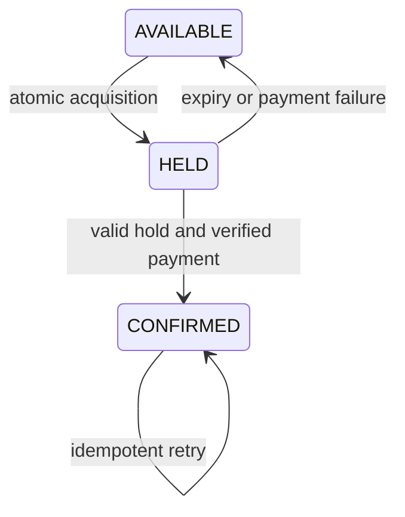

## 1. Absolutely Important Invariants

### Primary invariants

| Must remain true | Why it matters | What violates it | Enforcement |
| --- | --- | --- | --- |
| A seat has at most one confirmed owner. | Selling the same seat twice cannot be repaired by changing a cache. | Concurrent check-then-write or independent regional writers. | One authoritative conditional transition and uniqueness constraint per event/seat. |
| Confirmation refers to a valid, paid reservation. | Payment and inventory must agree on which customer owns the seat. | Payment callback confirms a hold that already expired and was reassigned. | Hold identity/version checks; explicit payment state; compensate late successful payments. |

### Supporting invariants

| Must remain true | Why it matters | What violates it | Enforcement |
| --- | --- | --- | --- |
| A hold confers ownership only until its authoritative expiry. | Abandoned carts must not lock inventory forever. | Relying on a delayed TTL cleanup job to enforce expiration. | Check expiry using database time in every transition; cleanup is housekeeping. |
| Retrying a logical booking does not charge twice. | Timeouts do not prove payment failed. | Client or worker issues a fresh provider charge after a lost response. | Persist request identity and provider idempotency key; reconcile unknown outcomes. |

## 2. Why the Naive Design Fails

Start with `Client → API → PostgreSQL` and a seat row.

```text
A reads A7: AVAILABLE, version 12.
B reads A7: AVAILABLE, version 12.
A writes HELD by Alice.
B writes HELD by Bob, overwriting Alice.
Both APIs say “your seat is reserved.”
```

Each request checked an obsolete fact outside the write. A transaction alone at Read Committed does not turn an ordinary read followed by an unconditional update into a safe reservation. Use a conditional update, a unique active-owner representation, or a row lock plus a recheck. Inspect the affected row count before promising success.

At 500,000 buyers for 20,000 seats, correctness is still a per-seat decision, but retries and connection queues become the availability bottleneck. A waiting room bounds admitted demand; it never grants ownership by itself.

## 3. Core Deep Dives

### High-contention concurrency control

**Problem:** Choose one winner for a scarce resource.

**Naive approach and why it fails:** Read AVAILABLE then write an owner; both callers pass the read.

**Common solution:** Atomic predicate update or a short SELECT FOR UPDATE transaction; serialize per inventory key.

**Trade-off:** Optimistic retries waste work at high contention; locks queue and can deadlock.

**Failure to probe:** A transaction waits while an external payment call hangs.

**Interviewer follow-up:** How do you acquire several adjacent seats atomically?

### Temporary ownership and fencing

**Problem:** Distinguish the current holder from expired work.

**Naive approach and why it fails:** Delete a Redis lock on TTL and assume the old worker stopped.

**Common solution:** Persist hold ID, version and expiry; condition every confirm/release on current ownership and authoritative time.

**Trade-off:** Expiry improves availability but creates late-payment compensation cases.

**Failure to probe:** An old holder resumes after the seat was reassigned.

**Interviewer follow-up:** Where is the stale hold rejected?

### Payment consistency and idempotency

**Problem:** Recover when provider and booking database disagree.

**Naive approach and why it fails:** Charge, then confirm; crash between the two.

**Common solution:** Durable payment attempt, stable provider key, guarded state machine, reconciliation and refund/void when confirmation is impossible.

**Trade-off:** There is a visible PENDING/UNKNOWN interval; compensation is not an atomic rollback.

**Failure to probe:** Provider succeeds but every callback is delayed beyond hold expiry.

**Interviewer follow-up:** Would you authorize before capture, and what does the provider guarantee?

### Flash-crowd admission

**Problem:** Keep contention from turning into infrastructure collapse.

**Naive approach and why it fails:** Let all 500,000 buyers compete on the same DB pool.

**Common solution:** Bound concurrent entrants, queue fairly if required, rate-limit retries and isolate availability reads.

**Trade-off:** Waiting-room latency and fairness policy become product choices.

**Failure to probe:** Bots consume admission tokens or users reconnect with many identities.

**Interviewer follow-up:** How do you measure fairness and avoid overselling while overloaded?

## 4. Canonical Solution Patterns

| Pattern | When to use it / problem it solves |
| --- | --- |
| Compare-and-swap | Let the authoritative row predicate select one winner. |
| Short pessimistic transaction | Serialize contended or multi-seat decisions; acquire locks in deterministic order. |
| Lease + ownership token | Reject an expired holder even when its process is still running. |
| Idempotency + reconciliation | Resolve payment uncertainty without issuing new logical charges. |
| Outbox | Commit confirmed booking and notification work atomically. |
| Admission control | Bound competing requests before they overload the authority. |

See the [cross-system pattern index](../../patterns/index.md) for the same mechanisms in other families.

## 5. Study Topics

### Optimistic concurrency on a seat

#### What problem does it solve?

Make the availability check and ownership change indivisible.

#### How does it work?

A database conditional UPDATE locks the matching row and rechecks the condition after competing updates. At PostgreSQL Read Committed, the loser finds the new version and affects zero rows.

#### Example

```sql
UPDATE seats
SET state = 'HELD', hold_id = :hold_id,
    expires_at = clock_timestamp() + interval '5 minutes',
    version = version + 1
WHERE event_id = :event AND seat_id = 'A7'
  AND state = 'AVAILABLE' AND version = 12
RETURNING version, expires_at;
```
Alice receives version 13. Bob’s version-12 predicate no longer matches after Alice commits. Zero rows is a conflict, not a successful hold.

#### Failure scenario

A commit response is lost. Persist a unique booking request key with the hold transaction so Alice can recover her existing hold rather than acquiring a second one.

#### Trade-offs

Under a hot-key storm most attempts lose. Backoff and admission control reduce wasted attempts; a lock may be simpler for a tiny multi-row transaction.

#### When would I use it?

Low-to-moderate contention single-resource updates, or as the final authoritative gate behind a waiting room.

#### Interview questions around this topic

What changes if you need three seats together, or use Repeatable Read?

### Expiry is a predicate, not a background event

#### What problem does it solve?

Prevent expired work from changing newly owned inventory.

#### How does it work?

All transitions lock or atomically update the seat and compare state, hold ID and expiry. Use database time evaluated at the ownership decision. Cleanup frees expired holds but correctness does not depend on prompt cleanup.

#### Example

```sql
UPDATE seats SET state = 'CONFIRMED', owner_id = :user
WHERE event_id = :event AND seat_id = :seat
  AND state = 'HELD' AND hold_id = :hold
  AND expires_at > clock_timestamp()
RETURNING seat_id;
```
Run this with the verified payment/booking updates in one short transaction; if no row returns, do not confirm.

#### Failure scenario

Hold H1 expires. H2 acquires A7. H1’s payment callback arrives. Matching hold_id rejects H1; refund or void its successful payment according to the payment state.

#### Trade-offs

Strict expiry can disappoint a user whose payment was slow. A documented grace period or bounded extension must still be enforced by the same authority.

#### When would I use it?

Temporary reservations, worker leases or any resource that may be reassigned.

#### Interview questions around this topic

Why does a Redis expiry notification not establish the moment of ownership transfer?

### Recovering an ambiguous payment

#### What problem does it solve?

Resolve successful external work after local crashes.

#### How does it work?

Persist attempt ID and provider idempotency key before calling. Treat timeouts as UNKNOWN. Query the provider or consume signed, deduplicated callbacks; perform one guarded transition and write an outbox event in the same transaction.

#### Example

P42 is persisted, provider charges, API crashes. Recovery queries P42: paid. If H42 is still valid, confirm it; if expired/reassigned, record a refund obligation with a stable refund key. Keep retrying and reconcile until settled.

#### Failure scenario

A refund request also times out. Creating a new refund key can duplicate compensation; retain the same logical refund identity and investigate unresolved attempts.

#### Trade-offs

Refunds may be delayed or fail. Do not describe a saga as an invisible database rollback.

#### When would I use it?

Booking plus an external payment provider, or any cross-authority business transaction.

#### Interview questions around this topic

How do you prove no UNKNOWN payment attempts are forgotten?

## 6. Quiz

Write or say your reasoning before opening the answers. Name the invariant, the failure window, and the recovery mechanism.

### Conceptual questions

1. What is the primary seat invariant?

2. Why can two readers both see AVAILABLE?

3. Does wrapping read and write in a transaction always fix it?

4. How does the losing CAS caller detect failure?

5. Why keep a unique hold ID?

6. Is a TTL sweeper required for expiry correctness?

7. Why not hold a database lock during payment?

8. What does a provider timeout mean?

9. Why is Redis alone a weak confirmation authority?

10. What does a waiting room guarantee?

### Scenario questions

11. Alice and Bob both update version 12. Explain the outcome.

12. Payment succeeds after H1 expires and H2 owns the seat. Recover.

13. 500,000 buyers target 20,000 seats. What is the bottleneck?

14. The primary fails after confirming but before responding. What should retry do?

15. Three seats must be booked together. What changes?

### Trade-off questions

16. Optimistic or pessimistic locking for a hot seat?

17. Short or long holds?

18. Fail open or closed if the ownership DB is unavailable?

19. Authorize then capture, or charge immediately?

20. One global authority or regional writers?

<details>
<summary>Reveal all 20 answers and reasoning</summary>

**1.** At most one confirmed owner per event/seat, enforced by the authoritative state transition rather than availability display.

**2.** Reads observe snapshots; neither read reserves the row. A later unconditional write can overwrite the other owner.

**3.** No. Isolation level and locking/predicates matter; ordinary Read Committed reads can still support a lost-update application pattern.

**4.** It checks affected rows or RETURNING. Zero rows means its expected version/state no longer holds.

**5.** It distinguishes the current lease from an old holder of the same seat and rejects stale callbacks.

**6.** No. Expiry must be checked in authoritative transitions. The sweeper improves housekeeping and displayed availability.

**7.** External latency or failure holds scarce connections and locks indefinitely; persist a lease and release the transaction first.

**8.** The charge outcome is unknown. It may have succeeded despite the missing response.

**9.** Eviction, failover policy or lost lock state can erase ownership. Confirmed inventory needs the promised durable authority and atomic transitions.

**10.** Bounded admission and perhaps fairness. It does not replace the database’s single-owner rule.

**11.** The database serializes updates on the row. After one commits version 13, the other version-12 condition fails; at stricter isolation it may instead get a retryable serialization error.

**12.** Reject H1 confirmation using hold ID and expiry, record payment success and a compensation obligation, then void/refund with a stable identity.

**13.** Admission, hot-row contention and DB connections can dominate before inventory is exhausted. Bound entrants, cache advisory availability and keep final ownership decisions authoritative.

**14.** Recover by the same booking key from an authority with the required durability; do not issue a fresh charge. Failover must fence the old primary.

**15.** Lock/check all three in deterministic order in one transaction or atomically enforce the group; on any conflict abort the whole local reservation.

**16.** Optimistic locking avoids waiting when conflicts are rare; short pessimistic serialization may reduce retry waste under contention. Neither increases the supply of the seat.

**17.** Short holds improve inventory turnover but increase payment-expiry races. Long holds improve checkout completion but enable inventory hoarding.

**18.** Fail closed for new confirmations; selling from stale cache risks double ownership. Browsing availability can degrade independently.

**19.** Authorization can reduce refund exposure, but capture/authorization expiry remain external states needing recovery. The provider contract and business timing decide.

**20.** A single seat requires coordinated ownership. Independent writers improve local availability but cannot both confirm during a partition without risking conflict.

</details>

## End-to-End Request Walkthrough

Buyer requests A7 with request key → admission check → transaction acquires a guarded hold and saves the request result → return hold ID and deadline → persist payment attempt → call provider with stable key → verify payment outcome → transaction checks current hold and expiry, confirms ownership and records outbox work → notification worker retries safely. If payment succeeds too late, compensation replaces confirmation.



## What If This Fails?

| Injected failure | Correctness and availability | Recovery |
| --- | --- | --- |
| Redis unavailable | Browsing/rate limiting may degrade; ownership remains correct in the database. | Reduce admission and use bounded authoritative reads. |
| Worker repeats confirmation event | Duplicate side effects are possible without identity checks. | Guard transitions and deduplicate notification/refund operations. |
| Expiry worker stops | Expired rows accumulate, but old holders must still fail confirmation. | Check time inline; restart sweeper and reclaim with guarded updates. |
| Provider response is lost | Payment outcome is unknown; blindly retrying a new charge breaks correctness. | Query/retry the same provider key and reconcile. |
| Service crashes between confirmation and publishing | Seat stays confirmed; notification is delayed. | Transactional outbox relay resumes after restart. |

## What Should Trigger In My Head?

**Booking →** single owner · atomic predicate · hold identity + expiry · ambiguous payment · compensation · bounded admission.
